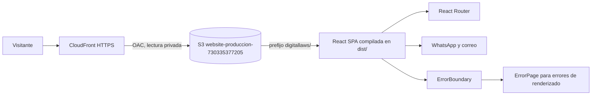

# Arquitectura

## Vista general

S3 no sirve los objetos de forma pública. CloudFront obtiene los archivos mediante Origin Access Control (OAC). La configuración actual usa el bucket compartido `website-produccion-730335377205`, prefijo `digitallaws/`, distribución `E3OHYZXSBN0Z41` y hostname `dzuoxek6sn2u.cloudfront.net`.

## Cliente web

`src/main.tsx` monta React y `BrowserRouter`. `src/App.tsx` declara las rutas y `src/layouts/SiteLayout.tsx` aporta navegación, pie, tema y contenedor principal. Las páginas reutilizan componentes de `src/components/` y recursos de `src/assets/`.

No hay servidor API propio en este repositorio. El build genera archivos estáticos en `dist/`, que CloudFront entrega al navegador. La aplicación no incluye mapa.

## Rutas

| Ruta | Componente | Propósito |
| --- | --- | --- |
| `/` | `HomePage` | Presentación, productos, aliados, seguridad y contacto |
| `/productos` | `ProductsPage` | Portafolio de productos |
| `/pqrs` | `PqrsPage` | Formulario y confirmación local de PQRS |
| `/seguridad` | `SecurityPage` | Información de seguridad |
| `/privacidad` | `PrivacyPage` | Política de privacidad |
| `/terminos` | `TermsPage` | Términos y condiciones |
| `/cookies` | `CookiesPage` | Política de cookies |
| Cualquier otra | `NotFoundPage` | Página no encontrada (404 de la SPA) |

Nginx está configurado con fallback SPA para Docker. En AWS, CloudFront maneja el fallback de las rutas de la SPA hacia `index.html`.

## Datos e integraciones

- **Errores de interfaz:** `ErrorBoundary` captura errores durante el renderizado de React y muestra `ErrorPage`. No sustituye el registro de errores de red o backend.
- **PQRS:** `PqrsPage` genera un identificador en memoria del navegador; al recargar la página la solicitud no queda guardada. La confirmación no prueba que se haya enviado correo.
- **Contacto:** enlaces directos `mailto:` y WhatsApp.
- **Privacidad:** Las variables `VITE_*` se incorporan al JavaScript público al compilar. Nunca se deben poner contraseñas, tokens privados ni credenciales de AWS en ellas.